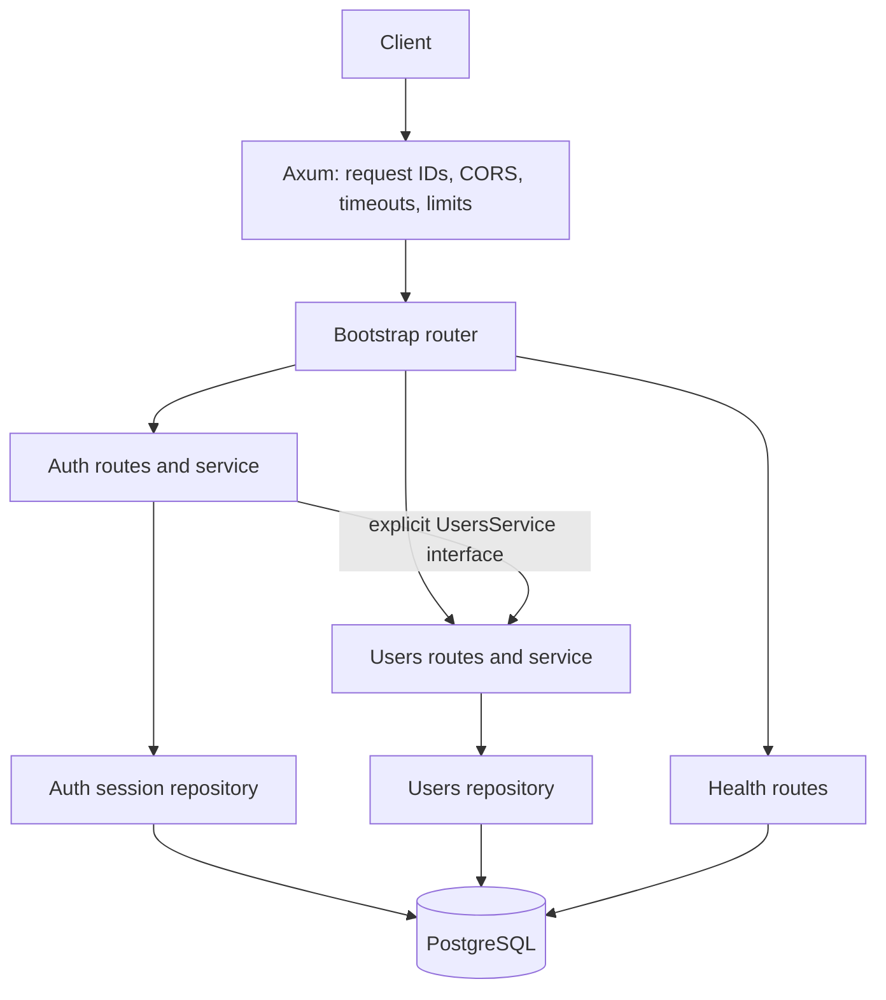

# Architecture

The application is one deployable service with one PostgreSQL database. It uses a modular monolith so a feature's HTTP adapter, business rules, queries, and tests stay close together.

## Directory ownership

| Directory | Responsibility |
| --- | --- |
| `src/config` | Pure configuration parsing and validation; secret fields have no `Debug` or `Serialize` implementation |
| `src/database` | Pool lifecycle, explicit migrations, readiness checks |
| `src/bootstrap` | Dependency construction and router composition |
| `src/middleware` | Auth extractor, request correlation and safe request logging, auth throttling |
| `src/shared` | HTTP errors, envelopes, input extractors, pagination |
| `src/modules/auth` | Passwords, signed access tokens, hashed refresh tokens, session lifetime and revocation |
| `src/modules/users` | Identity records, profile editing, current roles and activation status |
| `src/modules/health` | Liveness and schema-aware readiness |
| `migrations` | Immutable, ordered schema history |
| `tests` | Router contracts and database-backed behavior |

Modules keep repository and handler internals private. Their `mod.rs` files expose only routes and the service/data interfaces needed by callers. SQL belongs to repositories, with database infrastructure checks in `database`. Auth does not query or modify the Users table directly. Registration shares a transaction through the explicit Users service interface so account and session creation commit together. Password hashing finishes before taking a database transaction.

## Authentication design

Access tokens are HS256 JWTs tied to a session ID. Verification pins the algorithm and checks issuer, audience, required claims, issuance time, not-before time, and expiry. Every authenticated request also checks that the session remains active, then reads the current user role and account status. Logout, role changes, and deactivation therefore affect subsequent requests without waiting for JWT expiry. Authorization checks already in flight cannot be retroactively cancelled.

Refresh tokens contain 256 bits of cryptographic randomness. Only SHA-256 hashes enter PostgreSQL. A session has an absolute expiry; rotating refresh tokens never extends it. Rotation locks the session row, checks token consumption after obtaining the lock, consumes the previous token, and inserts a replacement in one transaction. Reusing an already consumed token revokes the entire session family and its access tokens. Tokens from other sessions remain independent.

Password hashing uses Argon2id with a unique salt, 19 MiB of memory, two iterations, and one lane. Blocking hashing jobs hold a semaphore permit even if the HTTP request is cancelled. Work beyond configured capacity receives 429. Login verifies a dummy hash for nonexistent users to avoid a cheap timing distinction. Registration requires 12 characters and limits passwords to 128 UTF-8 bytes; passwords are never trimmed or normalized.

## Data integrity

Users have a unique normalized email, database-enforced role and length constraints, and a trigger to update timestamps. Profile updates whitelist only the display name. The initial fixed roles are `user` and `admin`; a separate roles module/table is unnecessary until permission management becomes a business feature.

Users are sorted by `(created_at DESC, id DESC)` for deterministic pagination. Page items and count are read in one repeatable-read snapshot. Pagination is bounded to 100 rows and a finite offset; introduce cursor pagination if the data size makes offsets expensive.

SQL uses runtime `query_as`/bind parameters so builds do not need database credentials. Migration-backed integration tests verify the schema/query contracts. This choice avoids requiring a live database or SQLx offline metadata during compilation.

## Adding a feature

1. Add a real module with its routes, DTOs, service, repository, and model.
2. Export only its route constructor and required service interfaces.
3. Add a forward migration for its data and constraints.
4. Construct its dependencies in bootstrap and register its router under `/api/v1`.
5. Add business-rule tests and integration cases for permissions and database behavior.

Avoid global generic repositories, shared business models, empty modules, and a separate layer hierarchy merely for naming consistency. Extract a network service only when scale, ownership, or isolation requires it.
